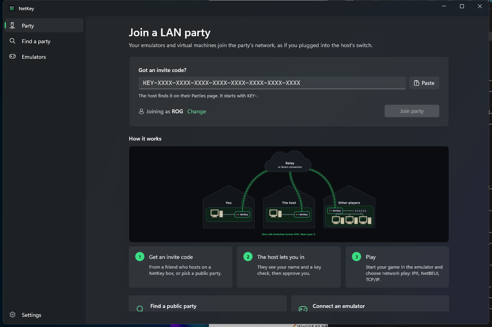
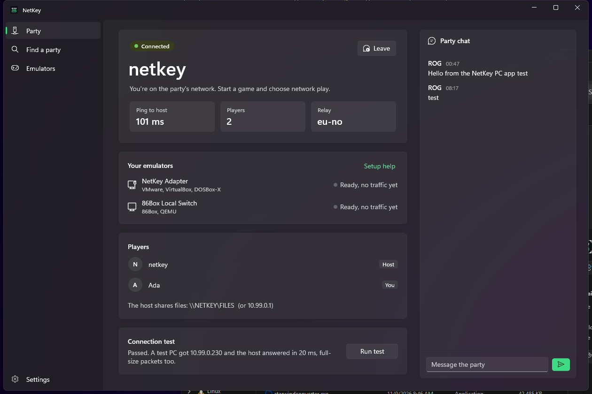
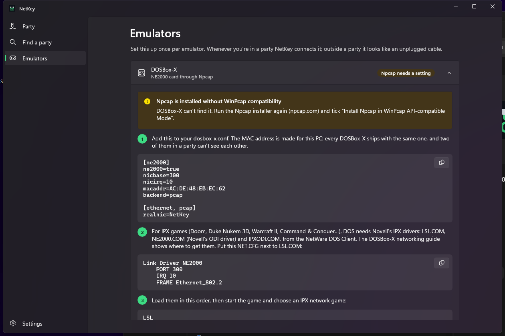

# NetKey for Windows

**Play old LAN games over the internet, from your emulators.** Doom, Duke Nukem 3D, Warcraft II, Command & Conquer,
Quake, Age of Empires: run them in DOSBox-X, VMware, VirtualBox or 86Box on your Windows PC, and play against
friends in other homes as if you were all at the same LAN party.



## Why do I need this?

In the 90s, multiplayer meant a **LAN**: a few PCs in one room, connected with network cables. Games found each other
on that cable using languages like **IPX** (Doom, Warcraft II, Duke Nukem 3D and most DOS games) or **NetBEUI**
(Windows file sharing).

The internet doesn't speak IPX, and it doesn't let games "shout" to find each other. So when you play those games in
an emulator today, the multiplayer menu works, but it can only find PCs in your own home.

**NetKey fixes that.** It connects your emulator to a LAN party hosted somewhere else, through an encrypted link.
To the game, it looks exactly like a network cable to your friend's house. Nothing to configure in the game, no
router settings, no port forwarding.

```
  Your PC                                        The host's home
  ┌──────────────────────────┐                   ┌───────────────────────────────┐
  │ DOSBox-X, VMware, 86Box  │                   │ NetKey box (a Raspberry Pi)   │
  │            │             │  encrypted link   │            │                  │
  │   NetKey for Windows ────┼── over the ───────┼──── the party's network ──────┼── old PCs,
  │                          │    internet       │                               │   other players
  └──────────────────────────┘                   └───────────────────────────────┘
```

## What you need

- A **Windows 10 or 11** PC (64-bit).
- An **emulator** with your game in it. Pick by the kind of game:

  | Your game runs on | Use | Extra install needed |
  |---|---|---|
  | **DOS** (Doom, Duke Nukem 3D, Warcraft II, C&C, Descent…) | [DOSBox-X](https://dosbox-x.com) | [Npcap](https://npcap.com) (free) |
  | **Windows 95, 98 or XP** (Age of Empires, StarCraft, Diablo, Red Alert 2…) | VMware Workstation or VirtualBox, with Windows inside | nothing |
  | **A whole retro PC** (any of the above) | [86Box](https://86box.net) | nothing |

- **A party to join.** Either a friend who hosts one on a **NetKey box** (a Raspberry Pi running
  [NetKey](https://netkey.no)) and sends you an invite code, or a public party from the list in the app.

You don't need a Raspberry Pi yourself to join. Only the host does.

## Quick start

1. **Install NetKey.** Download `NetKey-<version>-setup.exe` from [Releases](../../releases) and run it.
   Windows may say "Windows protected your PC", because the installer isn't code-signed yet (NetKey is free and
   non-profit): click **More info → Run anyway**.
2. **Set up your emulator once.** Open NetKey, go to **Emulators**, and follow the steps for yours (see below).
3. **Join a party.** Paste the invite code from your host, or go to **Find a party**. The host approves you.
4. **Play.** Start your game in the emulator and pick the network or IPX game in its multiplayer menu.
   The other players are there.

NetKey keeps running in the notification area when you close the window, so your party stays connected.



## Playing DOS games with DOSBox-X

This is the most common setup. You do steps 1–3 once; step 4 every time you play.



**1. Install DOSBox-X and Npcap.** Get DOSBox-X from [dosbox-x.com](https://dosbox-x.com). Then install
[Npcap](https://npcap.com) and **tick "Install Npcap in WinPcap API-compatible Mode"** (DOSBox-X needs it to
reach the NetKey Adapter). NetKey's Emulators page tells you if Npcap is missing or set up wrong.

**2. Give DOSBox-X a network card.** In NetKey, open **Emulators → DOSBox-X** and click **Copy** next to the
settings. Paste them at the end of your DOSBox-X config file (in DOSBox-X: *Main → Configuration tool*, or edit
`dosbox-x.conf`). They look like this, with a network address made for your PC:

```ini
[ne2000]
ne2000=true
nicbase=300
nicirq=10
macaddr=AC:DE:48:xx:xx:xx
backend=pcap

[ethernet, pcap]
realnic=NetKey
```

Every DOSBox-X has the same network address by default, and two of them in one party can't see each other. That's
why NetKey makes one just for you.

**3. Get the IPX drivers for DOS.** DOS games need Novell's IPX drivers: `LSL.COM`, `NE2000.COM` and
`IPXODI.COM`, from the NetWare DOS Client. The
[DOSBox-X networking guide](https://dosbox-x.com/wiki/Guide%3ASetting-up-networking-in-DOSBox%E2%80%90X) shows
where to get them and how to unpack them. Put them in a folder (for example `C:\IPX` inside DOSBox-X) together with
a file called `NET.CFG` containing:

```
Link Driver NE2000
    PORT 300
    IRQ 10
    FRAME Ethernet_802.2
```

**4. Every time you play:** join the party in NetKey, start DOSBox-X, and type:

```
C:\IPX\LSL
C:\IPX\NE2000
C:\IPX\IPXODI
```

Then start your game and choose an IPX network game. A few examples:

- **Doom / Doom II:** `IPXSETUP -nodes 2` (the number of players).
- **Duke Nukem 3D:** run `SETUP`, choose *Network game*, then start a game from `SETUP`.
- **Warcraft II:** *Multi Player Game → IPX Network*.
- **Command & Conquer:** *Multiplayer Game → Network*.

Tip: you can put the three driver lines in the `[autoexec]` section of your DOSBox-X config, so they load by
themselves.

## Windows games in VMware or VirtualBox

If your game needs Windows 95, 98 or XP, run that Windows in a virtual machine and connect it to the party:

- **VMware Workstation:** *Edit → Virtual Network Editor → Change Settings → Add Network* (for example VMnet2),
  set it to **Bridged** to **NetKey Adapter**. Then in your virtual machine's settings set the network adapter to
  *Custom: VMnet2*.
- **VirtualBox:** *Settings → Network → Attached to: Bridged Adapter → NetKey Adapter*.

The virtual machine gets its address from the party host, like a PC plugged into their network. Inside Windows, add
the **IPX/SPX protocol** to the network card if your game uses IPX (most 90s games do).

## 86Box

In 86Box, open *Settings → Network*, set the mode to **Local Switch**, and paste the **shared secret** from
NetKey's Emulators page. Nothing else to install.

## Is my real PC on the party?

No. Only your emulators and virtual machines join the party's network. Windows itself has its networking turned off
on the NetKey Adapter, so other players can't see your PC, your files or your printers.

## Questions

- **Is it free?** Yes, NetKey is free and non-profit.
- **Do I need a Raspberry Pi?** Not to join. The host runs NetKey on a Raspberry Pi (a NetKey box), and that's what
  makes the party. See [netkey.no](https://netkey.no) if you want to host one.
- **My friend can't see my game.** Everyone in the party must use the same IPX frame type (`Ethernet_802.2` above).
  Use the **Run test** button on NetKey's Party page to check your connection.
- **Can I host a party from this app?** Not yet: hosting needs a NetKey box.

## For developers

```
service/     netkeyd, the Windows service (Go): hub client, WireGuard (wireguard-go with its own TCP/IP stack),
             VXLAN to the party host, the switch, the NetKey Adapter and 86Box Local Switch ports, the named pipe
             the app talks to, install/uninstall
app/         the app (C#, WinUI 3, Windows App SDK): talks to the service over \\.\pipe\netkey
installer/   Inno Setup script, wizard artwork and third-party notices
```

The service does the work and keeps a party running when the window is closed; the app is only the window and the
notification-area icon.

### Building the installer (on Windows)

You need Go 1.26 or later, the .NET 10 SDK and Inno Setup 6:

```
winget install GoLang.Go Microsoft.DotNet.SDK.10 JRSoftware.InnoSetup
```

Then, from this folder:

```
powershell -ExecutionPolicy Bypass -File build-windows.ps1
```

It downloads TAP-Windows6 9.27.0 from OpenVPN's GitHub release (checked against a fixed SHA-256), builds the
service and the app, and writes `stage\out\NetKey-<version>-setup.exe`, plus the TAP-Windows6 source archive to
attach to each release.

### Tests

```
cd service
go test ./...
```

The service also builds and its tests run on macOS and Linux (without the adapter and the Windows service).

## License

Apache License 2.0, see [LICENSE](LICENSE) and [NOTICE](NOTICE). The name "NetKey" and the logo are not covered
by the license. Bundled third-party software and its licenses are listed in
[installer/THIRD-PARTY.txt](installer/THIRD-PARTY.txt).
